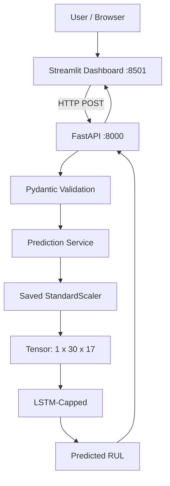

# Industrial Predictive Maintenance AI

An end-to-end predictive maintenance application that estimates the Remaining Useful Life (RUL) of simulated turbofan engines using the NASA C-MAPSS FD001 dataset. The project combines classical machine learning, deep learning, an inference API, an interactive dashboard, and Docker-based deployment.

> **Project status:** Research and portfolio MVP. The dataset contains simulated engine degradation trajectories; predictions are model estimates and are not a guarantee of physical failure time.

## Highlights

- Explores classical ML and deep learning approaches for RUL regression.
- Selects an LSTM-based model (`LSTM-Capped`) as the final deep-learning candidate.
- Uses a 30-cycle time window with 17 selected input features.
- Packages model weights, preprocessing scaler, feature metadata, and model configuration together.
- Serves predictions through FastAPI with Pydantic request validation.
- Provides a Streamlit dashboard for CSV upload, sensor inspection, and RUL prediction.
- Supports Docker and Docker Compose deployment with health checks, restart policies, and container logging.

## System Architecture



With Docker Compose, the Dashboard calls the API through the internal service name `http://api:8000`. On the host machine, the services are exposed locally at:

- Dashboard: <http://localhost:8501>
- API health: <http://localhost:8000/health>
- Swagger UI: <http://localhost:8000/docs>

## Dataset

This project uses the **NASA C-MAPSS Turbofan Engine Degradation Simulation Dataset**, subset **FD001**. C-MAPSS is a simulation dataset for studying engine degradation and prognostics, not a collection of live aircraft-engine telemetry.

- NASA Prognostics Center of Excellence repository: <https://www.nasa.gov/intelligent-systems-division/discovery-and-systems-health/pcoe/pcoe-data-set-repository/>
- Dataset archive linked from the NASA repository: <https://phm-datasets.s3.amazonaws.com/NASA/6.+Turbofan+Engine+Degradation+Simulation+Data+Set.zip>

The raw dataset is intentionally **not tracked in Git**. After downloading and extracting the archive (the archive may contain a nested `CMAPSSData.zip`), place the FD001 files in this layout:

```text
data/
└── raw/
    └── cmapss/
        ├── train_FD001.txt
        ├── test_FD001.txt
        └── RUL_FD001.txt
```

The Dashboard's **Load NASA Engine 1 Demo** action requires `test_FD001.txt` at that path. CSV upload and API inference do not require the NASA demo file, provided the user supplies a valid sensor CSV.

### Input sequence

The final inference pipeline expects exactly 30 consecutive cycles. Each cycle contains these 17 selected features, in the model's metadata-defined order:

```text
setting_1
setting_2
sensor_2
sensor_3
sensor_4
sensor_6
sensor_7
sensor_8
sensor_9
sensor_11
sensor_12
sensor_13
sensor_14
sensor_15
sensor_17
sensor_20
sensor_21
```

The `cycle_number` field is sequence metadata used for validation; it is not one of the 17 model input features.

## Modeling

The project experiments with multiple regression approaches:

- Linear Regression
- Random Forest
- XGBoost
- MLP
- LSTM
- 1D-CNN

The final deep-learning package is named **LSTM-Capped**. Its inference configuration is:

| Setting | Value |
|---|---:|
| Sequence length | 30 cycles |
| Input features per cycle | 17 |
| LSTM hidden size | 64 |
| Best training epoch | 30 |
| RUL cap used by the experiment | 125 |
| Validation MAE recorded in package config | 10.4193 |

### Reported evaluation results

The following are the recorded NASA FD001 official-test results from this project:

| Model | MAE ↓ | RMSE ↓ | R² ↑ | PHM08 score ↓ |
|---|---:|---:|---:|---:|
| Random Forest | 12.7535 | 17.5130 | 0.8224 | 720.4138 |
| LSTM-Capped | **10.7203** | **14.5724** | **0.8770** | **316.2619** |

Lower MAE, RMSE, and PHM08 score are better; higher R² is better. Metrics are reported from the project's saved evaluation results and should be interpreted in the context of the FD001 benchmark and its preprocessing/evaluation protocol.

Additional experiment outputs, comparisons, training histories, feature-importance tables, and plots are available in `reports/`.

## Repository Structure

```text
.
├── artifacts/
│   └── final_dl_model/
│       ├── lstm.pt
│       ├── standard_scaler.joblib
│       ├── feature_metadata.json
│       └── model_config.json
├── dashboard/
│   └── app.py
├── reports/
│   ├── *_metrics.csv
│   ├── *_predictions.csv
│   ├── *_training_history.csv
│   └── visualizations and analysis reports
├── src/
│   ├── api/
│   ├── data/
│   ├── evaluation/
│   ├── models/
│   └── services/
├── Dockerfile.api
├── Dockerfile.dashboard
├── compose.yaml
├── requirements.txt
├── requirements-production.txt
├── requirements-dashboard.txt
├── .dockerignore
└── .gitignore
```

The `artifacts/final_dl_model/` package is versioned because it is required for inference. Raw datasets, intermediate training artifacts, and local virtual environments are excluded from Git.

## Run Locally (without Docker)

Use Python 3.13 and create a virtual environment:

```powershell
python -m venv .venv
.\.venv\Scripts\Activate.ps1
python -m pip install -r requirements-production.txt
```

Start the API in one terminal:

```powershell
python -m uvicorn src.api.main:app --host 127.0.0.1 --port 8000 --reload
```

Start the Dashboard in a second terminal:

```powershell
python -m streamlit run dashboard/app.py
```

Open <http://localhost:8501>. The local Dashboard defaults to `http://127.0.0.1:8000` for the API. The API documentation is available at <http://localhost:8000/docs>.

## Run with Docker Compose

### Prerequisites

- Docker Desktop with the Docker Engine and Docker Compose plugin available.
- The final model package under `artifacts/final_dl_model/`.
- For the NASA demo button, the FD001 dataset at `data/raw/cmapss/test_FD001.txt`.

The Compose file mounts `./data/raw/cmapss` into the Dashboard container as read-only data. The raw dataset is not copied into the Dashboard image and is not tracked by Git.

Build and start both services:

```powershell
docker compose up -d --build
```

Check service status:

```powershell
docker compose ps
```

View logs:

```powershell
docker compose logs -f api
docker compose logs -f dashboard
```

Stop the application:

```powershell
docker compose down
```

### Service endpoints

| Service | Host URL | Purpose |
|---|---|---|
| Streamlit | <http://localhost:8501> | Dashboard |
| FastAPI health | <http://localhost:8000/health> | Backend and model readiness |
| Swagger UI | <http://localhost:8000/docs> | Interactive API documentation |

The Compose configuration binds published ports to `127.0.0.1`, so the services are intended for local access by default. For remote or public deployment, add an appropriately configured reverse proxy, TLS/HTTPS, authentication, and network controls before exposing the application.

## API

### `GET /health`

Returns backend status and whether the model package was loaded.

### `POST /api/v1/predict/rul`

Accepts an engine identifier and exactly 30 consecutive cycle records. Each record must contain `cycle_number` and all 17 selected features. Pydantic rejects missing fields, unsupported extra fields, invalid numeric values, and incorrectly sized sequences. The prediction service also checks that cycle numbers are consecutive.

The response has this shape:

```json
{
  "engine_id": "ENGINE-001",
  "predicted_rul": 115.0325,
  "unit": "cycles",
  "model": "LSTM-Capped",
  "status": "success"
}
```

The numeric value above is an example from the project's Engine 1 smoke test, not a fixed response for every input.

## Testing

Run the API validation/regression tests with the FastAPI service available:

```powershell
python -m src.api.test_api_errors
```

Other scripts under `src/api/` and `src/evaluation/` can be used for additional validation and inference checks, depending on which test files are present in the checkout.

For a deployed Compose stack, check:

```powershell
docker compose ps
Invoke-RestMethod http://localhost:8000/health
Invoke-WebRequest http://localhost:8501/_stcore/health
```

## Operational Notes and Limitations

- The packaged PyTorch model is configured for CPU inference in the Docker API image.
- The API validates the sequence contract before inference; it does not train or update the model at request time.
- The model output is an estimate of remaining cycles. It should not be used as the sole basis for safety-critical maintenance decisions.
- The current Compose setup is a local single-host MVP, not a fully hardened public production deployment. Authentication, TLS termination, rate limiting, centralized monitoring/alerting, and load testing remain deployment extensions.
- The NASA demo dataset is optional for CSV-based inference but required for the Dashboard's bundled Engine 1 demo workflow.

## Acknowledgements

The dataset is provided through the NASA Prognostics Center of Excellence data repository. Please cite the dataset and its associated publication when using it in research or derivative work:

A. Saxena and K. Goebel (2008), *Turbofan Engine Degradation Simulation Data Set*, NASA Prognostics Data Repository, NASA Ames Research Center, Moffett Field, CA.

See the [NASA PCoE Data Set Repository](https://www.nasa.gov/intelligent-systems-division/discovery-and-systems-health/pcoe/pcoe-data-set-repository/) for the dataset description and citation information.
